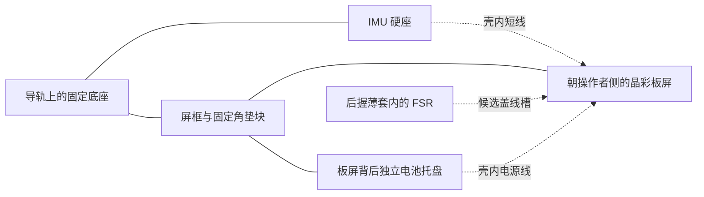

# 通用导轨机械接口方案

## P0-A：悍迪 191 原型布置候选

2026-11-13 · `CANDIDATE`。先以可拆、非磁性夹具做固定角度样件。将带壳晶彩板屏、外置 IMU 和后续电池都收进同一个导轨附件的轮廓，后握薄套只放传感片。导轨夹具和电子壳分件，便于换载体时复用电子部分。 [硬件计划 §0.1.2](HARDWARE_IMPLEMENTATION_PLAN.md#012-单板传感器与电脑无线连接)



上图表示机械连接和线束关系，位置、侧别及尺寸由假体验证。先从**靠近后握、同时避开操作空间的固定导轨段**试起。把 94.5 × 62 mm 的屏幕纸样贴在独立角垫块上，左右两侧各试一次；能看清画面、自然点触、戴手套可操作并可拆装的一侧进入试制。若近后握位置挡手或挡活动件，沿同一固定段向前移，重验后握出线。尺寸来自晶彩外壳规格图，纸样再加实际插头、线弯、保护框和电池厚度。 [晶彩板屏规格](https://www.guition.com/esp32-display-module/3-5-inch-esp32s3-display-module)

| 部位 | 优先布局 | 现场判据 |
| --- | --- | --- |
| IMU | 放在屏幕后方靠导轨夹具的**固定根部**，尽量靠近底座与板屏扩展口。小板落在平整、有定位的刚性小座上，与夹紧螺钉的受力面、热源及 USB 插头受力处留开。 | 按屏和插拔线束时小板不被带动。空载和装屏后各测静止偏移；轻碰壳体后回到同一静止读数。 [TDK MEMS 装配指南](https://invensense.tdk.com/wp-content/uploads/documentation/AN-000393_TDK-InvenSense-IMU-PCB-Design-and-MEMS-Assembly-Guidelines.pdf) |
| 屏幕 | 固定角垫块先定视角，边框做承力边和薄缓冲，玻璃前表面让出触摸区。留 USB-C 插拔、BOOT/RESET 操作及检修盖空间。 | 靠放时由框架边缘先接触平面，手或平面不挤压玻璃、电池与 PCB。静态检查挂带和所有现有操作件、拆装路径。 |
| 电池 | 首选屏幕后盖**靠近固定底座、避开天线的一侧**设独立绝缘托盘。备选为导轨底座的固定侧腔，适用于屏背厚度、温升或射频净空不足时。 | 先用带线等尺寸、等质量假体。电池仓有独立检修盖和线束夹，按电池规格留厚度和膨胀余量，承力螺柱及尖边绕开软包。定位天线后把乐鑫建议的 15 mm 净空作为布置检查点，用实物验证装壳及手遮挡下的 Wi-Fi。 [乐鑫天线布局指南](https://docs.espressif.com/projects/esp-hardware-design-guidelines/zh_CN/latest/esp32s3/pcb-layout-design.html) |
| 后握 FSR | 试在后握背面中段略偏上、掌心自然压住的一带。薄套做局部平面和压垫。尾片沿握套边缘出线，过渡到线束后从附件盖线槽进板屏后盖。 | 戴手套和左右手都试握。握套可独立拆，接头在盖内、可拔、两端有应变释放。只接受有连续遮护、能拆装且避开活动件的线路。 |
| 前握 FSR | 仅在确实需要前手/双手证据时，比较现有下导轨后段的小压片和护木外侧薄压片，位置由支撑手实际接触区决定。 | 安装后自然握持即可压到。若候选落在手以外，移动压片；把外露体积和手感一起记录。 [P0-A 传感器候选](SENSOR_OPTIONS.md#p0-a单板传感器设计候选) |

固定角样件通过后，若确实需要收折，先试单轴限位。IMU 留在底座固定侧，优先把电池也留在固定侧；越轴线束验证弯曲半径、活动两端余量和应变释放。固定载体单独拨动屏幕时，稳定后的姿态应回到同一读数，内核不应切换为举起或放低。三轴属于后续角度和重量都验证后的结构选择。

| 断电假体实测 | 记录内容 |
| --- | --- |
| 固定段与左右净空 | 顶视、左右侧视各一张含标尺照片，标出候选槽位、手掌、活动件、挂带、接头与可视窗口；记录最小净空及对应操作。 |
| 板屏与电池 | 实测原壳长宽厚、背面突出点、USB-C 插头及弯线厚度、可用后盖腔及最重假体，记录装上前后的重量和握持体感。 |
| 后握与线槽 | 用纸胶带标出戴手套时的掌心接触区，量握套出线点到板壳入口的实际路径及可容纳截面，验证拆套和拔接头。找不到连续保护路径时，先完成板屏与 IMU 原型。 |

下文通用导轨接口继续适用，三轴显示舱与双 BLE 区域节点属于 P0-B。

## 1. 目标边界

套件目标是让同一电子核心能够在不同 wargame 载体之间迁移。首发机械基线是标准皮卡汀尼导轨；没有该接口的载体使用独立机械转接件。

「通用」的准确含义：

- 电子核心、协议和软件不随载体改变。
- 标准皮卡汀尼载体复用同类底座。
- M-LOK、KeyMod 或无导轨载体通过可更换底座/转接件处理。
- 不承诺一个固定夹具无需测量即可适配字面意义上的每一把载体。

## 2. 模块边界

```text
电子核心
  display pod: screen + main board + rechargeable battery + network
        │
        └── 3-axis constant-torque arm
                    │
                    └── fixed sensor root: rail-referenced IMU
                                │
                                └── rigid mechanical interface
                                            ├── Picatinny base（首发）
                                            ├── M-LOK adapter（后续）
                                            ├── KeyMod adapter（后续）
                                            └── strap/adhesive fixture（独立评审）

前下导轨节点与后握把节点不属于显示主机舱底座。它们通过各自的可逆固定件安装，并通过 BLE 与主机通信；更换载体时只需要更换节点固定件、assembly transform 和校准配置。
```

电子壳体与导轨夹具分离设计。更换载体时优先换底座，不重做电路、状态机和屏幕软件。

## 3. v0.1 机械原则

- 快拆、非承力、可逆安装。
- 导轨夹具刚性锁定、不得用沿导轨滑移制造阻尼；屏幕角度由 yaw/pitch/roll 三轴转轴的恒扭矩/预紧摩擦保持。
- 不接内部火控、扳机、供弹或动力结构。
- 不要求机内走线。
- 不遮挡瞄具、主要操作件、握持区和拆装路径。
- 线缆留在主套件内部；外部功能节点使用无线，自带电源和可逆固定。外部有线只允许台架采样，不进入默认上枪形态。
- 断电套件先做装配检查，通过后才做通电静态测试。
- 实物测量是 SSOT；宣传尺寸、网图和第三方模型只作参考。
- 固定 IMU 位于独立前下导轨 BLE 节点，屏幕转动不能改变载体参考姿态。
- 三个有线转轴都有硬限位与应力释放，不使用无限旋转或滑环。
- 屏幕边框泡棉先接触收纳平面，LCD 与电池均不得成为结构承力件。

## 4. P0-B 历史载体参考

原 P0-B 结构方案以森柏龙 RADIAN MODEL 1 作为参考，曾列出以下验证项：

- 皮卡汀尼底座能否可靠快拆。
- 屏幕在收起/展开时的视线与操作净空。
- 三轴屏幕能否从不同导轨位置调整到可视角并贴身收纳。
- 屏幕、Linux 小板和主电源一体移动时的质量、重心、厚度与突出感；P0 不跨轴连接固定 IMU。
- 套件重量和位置是否明显破坏重心。
- 前下导轨固定 IMU 能否在不同底座与 assembly transform 下获得稳定动作特征。

RADIAN 专属测量与外壳数据进入独立适配记录，不反向污染通用电子核心。

## 5. 设计记录要求

每次机械试制记录：

| 字段 | 内容 |
|------|------|
| revision | 设计编号与日期 |
| carrier | 载体与导轨类型 |
| measured_clearance | 实测净空与测量方法 |
| mount | 底座/夹具版本 |
| module_layout | 一体/分体与安装位置 |
| mass | 模块与整套重量 |
| display_axes | 三轴角度包络、操作力、保持力矩与限位 |
| cable_cycles | 跨轴线缆循环次数与异常 |
| battery_dummy | 主电池等质量/等厚度假体版本 |
| observations | 视线、操作、松动、线缆、拆装 |
| decision | 保留、修改或淘汰及原因 |

决定一旦影响通用接口，追加到 `DECISIONS.md`；单次载体试验留在后续 `design-records/`，不把失败方案从历史中删除。
